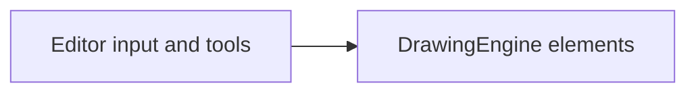
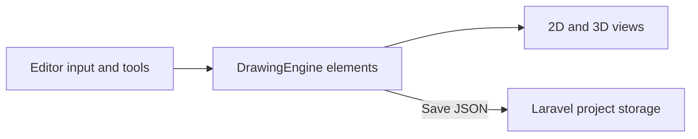

# Mini CAD architecture

Mini CAD is a browser editor for wall and column layouts. Laravel serves the pages and stores projects. JavaScript owns the working drawing, and both the 2D canvas and 3D viewer display that same drawing.

## From a Blade page to a working editor

[Web routes](routes/web.php) require session authentication for project pages and the editor. After login, `/projects` shows the signed-in user's projects. Opening a project requests `/editor/{project}`. The PHP [ProjectController](app/Http/Controllers/ProjectController.php) checks ownership before rendering the page. `/editor` opens a blank drawing.

[editor.blade.php](resources/views/editor.blade.php) supplies the controls, drawing canvas, preview canvas, and 3D container. For an existing project, it embeds JSON containing `id`, `name`, `elements`, and `version`. Vite loads the stylesheet and [app.js](resources/js/app.js).

`app.js` constructs the engine, tools, views, and browser project controller. `restoreElements()` rebuilds saved records as `Wall` and `Column` instances before replacing the engine's drawing. This restores their methods and runs constructor validation. A failed restore locks the editor and reports an error instead of opening a partial drawing. Opening uses the embedded page data rather than a separate browser fetch.

There are two `ProjectController` classes. The PHP controller handles requests and storage. The JavaScript controller tracks the open project's identity, version, unsaved state, and save operation.

## The working drawing

[DrawingEngine](resources/js/cad/DrawingEngine.js) stores committed elements in `elements`. Each element has a UUID and type. Walls hold reference endpoints, thickness, height, and `thicknessSide`. Columns hold a corner position, width, depth, and height. Coordinates and dimensions use millimeters.

Input changes this collection through engine methods:

`EditorController` converts pointer pixels to drawing coordinates and routes events. `WallDrawingTool` holds the unfinished wall, applies alignment and Ortho constraints, and uses `SnapManager` for endpoint or segment snapping. Pointer movement changes a temporary preview. A second click or numeric-length action commits through `addWall()`.

Adding a wall can split reference segments at intersections. `WallTopology` discovers closed rooms, and the engine can adjust thickness sides around a newly completed room. Collinear overlaps and additions exceeding 1,000 elements are rejected before committing the new collection.

Preview state, selection, pan, and camera position are separate from committed geometry. They are not saved in the element JSON.

## Selection and editing

[SelectionManager](resources/js/cad/interaction/SelectionManager.js) owns one `selectedElements` array. It derives `selectedIds` as a Set for rendering. Its `selectedElement` getter returns an element only when exactly one is selected. The `cad-selection-change` event supplies that sole element, or null, to property panels.

[SelectionTool](resources/js/cad/interaction/tools/SelectionTool.js) owns click, box, drag, and deletion gestures. Click selection checks visible footprints in reverse drawing order. A double-click-and-hold box selects elements whose footprints lie fully inside it. Ctrl/Cmd+A selects all elements in 2D.

Column dragging moves its position. Single-wall dragging moves perpendicular to the wall and updates exactly shared endpoints on connected walls. Group dragging translates the selected elements together. Single and group deletion both call `engine.removeElements(selectedIds)`, then clear selection and gesture state.

Escape cancels pending gestures and clears selection without undoing movement already committed during a drag. Delete and Backspace act on drawing selection only in 2D and outside input fields.

## One drawing, two views

The drawing feeds both views:

Wall reference edges supply measured lengths and saved data. `WallGeometry` derives display footprints for supported joins without changing those reference edges. `GeometryService` supplies coordinate calculations. Unsupported or unsafe joins retain base footprints, so the solver still has limits.

The engine caches wall footprints. Wall mutations invalidate the cache before notifying listeners because a listener may request geometry immediately. Column-only deletion preserves the cache. This ordering contract is documented in `DrawingEngine.handleModelChange()`.

`app.js` connects model changes to unsaved state, a scheduled 2D redraw, and 3D synchronization. `DrawingView` passes resolved footprints and the selected-ID Set to `CanvasRenderer`. The renderer applies pan and zoom when converting millimeters to pixels. `WallPreviewRenderer` draws temporary walls, guides, and selection boxes on the separate preview canvas.

`ViewportController` creates `ThreeViewer` when 3D first opens. Walls become extruded footprints and columns become boxes. The viewer converts 1,000 millimeters to one scene unit. Drawing X and Y become scene X and Z. Scene Y represents height.

Unchanged meshes are reused by element ID and geometry signature. Changed or removed meshes release their geometry and materials. Hidden 3D waits to synchronize until shown again. Navigation changes the view without changing stored dimensions.

## Saving and reopening

Saving adds the server connection:

Save and Ctrl/Cmd+S call the browser project controller. It checks the name and locks editing while [ProjectService](resources/js/cad/persistence/ProjectService.js) sends JSON through `fetch` with the Blade page's CSRF token.

A new project uses `POST /projects` with `name` and `elements`. An existing project uses `PUT /projects/{id}` with its last saved `version` as well. `SaveProjectRequest` checks supported types, distinct UUIDs, finite coordinates, positive dimensions, allowed element properties, distinct wall endpoints, and the 1,000-element limit.

Laravel creates projects through the authenticated user's relationship. `ProjectPolicy` checks ownership for individual records and returns 404 for another user's project. Each project row stores its owner, name, JSON element array, version, and timestamps. Individual drawing elements have no separate database rows.

Updates match both ID and version, then increment the version. A stale save receives HTTP 409 and leaves local work available. There is no automatic merge. Success records the returned ID and version, updates the editor URL, and clears unsaved state. Failure reports the error and retains the drawing. Editing unlocks when the request finishes.

Saving is manual. The browser warns before leaving with unsaved changes. New Project confirms discarding the working drawing and creates no database row until saved. Server JSON read endpoints remain available, although the editor opens saved drawings through Blade.

## Where to look next

| Location | Responsibility |
| --- | --- |
| `resources/views/` | Authentication, project-list, and editor pages. |
| `resources/js/app.js` | Browser object construction and change callbacks. |
| `resources/js/cad/models/` | Element identity, dimensions, and basic footprints. |
| `resources/js/cad/geometry/` | Calculations, topology, room discovery, and display joins. |
| `resources/js/cad/interaction/` | Input routing, tools, selection, snapping, and navigation. |
| `resources/js/cad/rendering/` | 2D drawing, previews, 3D meshes, and view switching. |
| `resources/js/cad/persistence/` and `ui/` | Project state, HTTP writes, reconstruction, and control bindings. |
| `app/Http/`, `app/Models/`, and `app/Policies/` | Server requests, validation, storage models, and ownership. |
| `database/migrations/` | Database schema. |

The separation appears to make editing rules easier to test independently of rendering. That broader motivation is an inference. The shared drawing and separate view implementations are directly visible in the code.

Engine mutations keep caches, unsaved state, and views synchronized. Direct field or array edits can bypass that work. Saved-data changes reach model constructors, `restoreElements()`, server validation, existing saved projects, and persistence tests. The loader accepts legacy string thickness sides, while new saves require integer values.

Vitest checks browser-side behavior in `resources/js/cad/tests/`. PHPUnit checks server behavior in `tests/`. Their commands are `npm test` and `php artisan test`. `npm run build` builds production assets. The local [verification skill](.agents/skills/verify-mini-cad/SKILL.md) documents browser journeys and evidence capture when installed.
